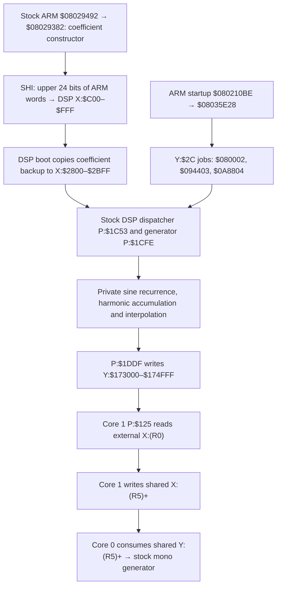

> Research/design evidence with its original experimental scope. Historical blockers and next steps below are not current project instructions; see [current state](../docs/CURRENT_STATUS.md).

# Stock lookup provenance: X:$173000 / X:$174000

2026-10-15. **STOCK WAVETABLE TABLE PROVENANCE = QUALIFIED**, for the reconstructed stock initialization path and the documented external-word representation below. The complete retained master-audio replay and Layout A's P budget remain **UNKNOWN / UNQUALIFIED**. No Plaits port, firmware image, hardware access or reference-repository modification occurred.

The previous report missed a real stock constructor. These wave bytes are not simply absent content requiring another dump: **the verified firmware generates them at startup**. The original application contains both the coefficient constructor and DSP generator. This report supersedes the earlier claim that an external table artifact was necessarily missing.

## 1. What the two addresses contain

**PROVEN:** `$173000–$174FFF` contains 8,192 consecutive computed waveform sample words. `$174000` is the midpoint of this cycle, not the start of a separately initialized slope/coefficient table. There is one uninterrupted sequence of 8,192 stores at DSP core 0 P:`$1DDF`, each `move b,y:(r5)+`, beginning at `$173000`. The core-1 view reads the same external data through X.

**PROVEN:** the selected voice's prepared base fields are both `$173000`: core 0 P:`$450/$451` writes X:`$582/$583`. The request generator at `$90B–$913` computes two phase indices from the same base; its first requests are `$173000` and `$174000`. The `$1000` separation is the half-cycle phase displacement in this observed path. It is not evidence of a value/slope pair. Wave-info records carry a `$1FFF` index mask. The two half-cycle boundary values are `$000000` and `$FFFF00`; the fixed-point boundary residual is retained rather than replaced with an ideal mathematical zero.

**STRONG INFERENCE:** this is a coarse, single-harmonic level of the stock harmonic waveform family whose allocation base is `$151000`. The coefficient series and progressive harmonic construction support a band-limited harmonic-bank interpretation. Exact commercial waveform names and every parameter-dependent interpretation remain **UNKNOWN**; provenance does not depend on assigning those names.

Evidence: core0.asm (local-only reference: `builds/phase20k-stock-wavetable/core0.asm`; not distributed), P:`$387–$46D`, `$90B–$913`, `$1C94–$1DA8`, `$1DD5–$1DE3`; generation traffic (local-only reference: `builds/phase20k-stock-wavetable/generation/generation-traffic.txt`; not distributed); strict stock traffic (local-only reference: `builds/phase20k-stock-wavetable/strict-64/traffic.txt`; not distributed).

## 2. Proven original source and initialization chain

The original source artifact is **official stock 4486**, not a user PCM file or patch bank:

| Artifact | Size | SHA-256 |
|---|---:|---|
| Official stock BIN (local-only reference: `C:/Proj SSD/CODEX/CIRCUITS-HACKS-RC-main/CIRCUITS-HACKS-RC-main/stock/circuittracks-firmware-4486-STOCK.bin`; not distributed) | 314,844 bytes | `b897e0f01c403974eafae32074876234f2da7ef834796a485993acf01423f8da` |
| Official stock SYX (local-only reference: `C:/Proj SSD/CODEX/CIRCUITS-HACKS-RC-main/CIRCUITS-HACKS-RC-main/stock/circuittracks-firmware-4486-STOCK.syx`; not distributed) | 432,961 bytes | `bd2d294bafa88fdec7ae1f5fcaaa13158323969c5a40f83405a72e4ad329a0bd` |

**PROVEN:** decoding the existing SYX yields the BIN exactly. The previously verified flash dump's application slice also matches this BIN. The stock DSP stream is read from its existing bootstrap descriptor; no firmware builder was called.

The path is:



### Coefficient source

**PROVEN:** ARM `$08029492` calls `$08029382`. Its first coefficient argument is the little-endian literal `$7FFFFF00` at flash `$08029678`. The next 1,023 coefficients use `$0803B898`, which performs integer division plus a 16-bit fractional remainder step. For input numerator 32,768 and divisor `n`, the result is `floor(2^31/n)`; SHI transmits bits 31:8. The resulting DSP coefficients are:

```text
C[0] = $7FFFFF
C[k] = floor(2^23 / (k + 1)), k = 1..1023
```

All 1,024 actual ARM-emitted values were checked against this formula. They were not substituted by it. DSP P:`$25F8–$25FF` copies X:`$C00–$FFF` to X:`$2800–$2BFF` after the ARM init writes are present.

Exact instruction evidence: ARM SHI/init listing (local-only reference: `builds/phase20k-stock-wavetable/arm-shi.asm`; not distributed), `$080291E0–$080291FE`, `$08029382–$080293BA`, `$08029492`; division helper (local-only reference: `builds/phase20k-stock-wavetable/ARM-coefficient-divide.asm`; not distributed), `$0803B898–$0803B8AA`; coefficient bytes (local-only reference: `builds/phase20k-stock-wavetable/source-coefficients.be24`; not distributed).

### Real ARM table constructor

**PROVEN:** ARM startup directly calls `$08035E28` at `$080210BE`. The constructor starts its destination at `$100000`, posts to encoded Y address `$802C`, polls for `$80000000` in ARM readback representation, and advances its allocation pointer by `$28800` for the first three families.

| ARM ordinal | Selector / DSP mailbox word | Base | Executed DSP destination footprint |
|---:|---|---|---|
| 0 | 2 / `$080002` | `$100000` | `$100000–$10FFFF`, 65,536 words |
| 1 | 3 / `$094403` | `$128800` | `$128800–$14C7FF`, 147,456 words |
| 2 | 4 / `$0A8804` | `$151000` | `$151000–$174FFF`, 147,456 words |

These are observed write footprints, not the larger allocation strides. Indices 3–12 alias the preceding base in the ARM pointer map instead of creating ten additional families. The first three real pointer stores at ARM `$20005D40` are `$100000`, `$128800`, `$151000`.

For selector 4, P:`$1C94` restores the original coefficient backup, sets `$3EB852` as the recurrence's initial Y1 value, and invokes `$1CFE` with primary count `$2000`. At P:`$1D0F–$1D18`, the initial output pointer is `base + 17 * $2000 = $173000`. The private recurrence uses coefficient `$00C910`, with its 1,024-point working cycle at Y:`$1400`; harmonic accumulation uses X:`$2400`-area workspace. P:`$1DD5–$1DE3` expands working samples in groups of eight. The target cycle's sequential writer is P:`$1DDF`.

The complete selector-3 and selector-4 jobs each require **327 actual dispatcher calls** before the real DSP completion sentinel appears. The extractor does not declare a job complete merely because it was posted. Selector 2 completes in one call. A previous static interpretation of its short immediate as integer one was insufficient: its actual DO count is `$10000`, producing 65,536 words.

Evidence: startup caller (local-only reference: `builds/phase20k-stock-wavetable/ARM-startup-caller.asm`; not distributed); constructor (local-only reference: `builds/phase20k-stock-wavetable/arm-table-init.asm`; not distributed); captured ARM posts (local-only reference: `builds/phase20k-stock-wavetable/ARM-generator-posts.json`; not distributed); actual job completions (local-only reference: `builds/phase20k-stock-wavetable/generation/output.txt`; not distributed).

The bounded ARM capture models the ready reply only to record its intended first three posts. It stops at `$08035E48` with ordinal 3; it does **not** claim to execute the complete constructor. The offline DSP replay then independently executes and completes every recorded job in order. Other peripheral/RTOS timing remains modeled.

## 3. Reader and writer census

### Readers supported by the executed path

| Core / site | Addressing / range | Role |
|---|---|---|
| Core 0 P:`$90B–$913` | Masked phase arithmetic plus prepared bases; writes **addresses**, not target data, to shared X:`(R2)+` | Builds the two-phase stock voice lookup requests. Surrounding `$936–$94D` handles the adjacent-sample interpolation variant. |
| Core 1 P:`$120` | `move x:(r5),r0` | Loads an external request address from shared SRAM. |
| Core 1 P:`$125` | `move x:(r0),x0`, no address update | The actual target reader. Range is determined by the request, not a hard-coded `$173000` literal. |
| Core 1 P:`$126` | `move x0,x:(r5)+` | Replaces the request with the returned sample. |
| Core 0 P:`$929/$92B`, alternative `$965–$96B` | Shared `y:(r5)+`, MAC/interpolation operations | Consumes returned direct waveform samples and combines weighted phase contributions. It does not directly read the high external address in this stock voice path. |

**PROVEN:** all **6,528** target-region reads observed in the 64-block strict replay occur at core-1 P:`$125`, and every value equals the reconstructed address-indexed word. Core 0's two prepared bases are the same; the phase indices explain the first pair's `$1000` displacement.

The current path's mask supports an 8,192-word cycle. This does not establish every other waveform's mask, length, or mip level. A stock indirect-address census is preserved in stock-indirect-census.json (local-only reference: `builds/phase20k-stock-wavetable/stock-indirect-census.json`; not distributed): **2,342 lexical indirect candidates**, including unreachable/data-decoding candidates. It is an inventory, not a completed global points-to proof. **UNKNOWN:** exhaustive reader closure for arbitrary selectors, malformed controls, service operations and all firmware modes.

### Writer/initializer mechanisms

| Mechanism | Source → transport → destination / timing | Conclusion |
|---|---|---|
| Actual stock constructor | ARM-derived reciprocal coefficients → SHI → private coefficient backup → selector 4 generator → Y:`$151000–$174FFF`, including target cycle | **PROVEN normal source** of the recovered data at startup. |
| DSP loader/bootstrap | Existing official packed 24-bit program stream → ARM `$08029200` → DSP P program; coefficient initialization follows separately | **PROVEN** source of generator code, not a direct wave-payload copy. |
| Inter-core gather | Requested external X word → shared X slot | **PROVEN reader/copy service**, not the initializer of the external word. |
| Later constructor content records | Flash descriptors at `$080567EC`, 12-byte stride; e.g. source offset `$82000`; `$08047C6C` virtual storage read → 512-byte staging records at X:`$C00` → selector 0 jobs | **PROVEN separate constructor branch** at ordinals 14–29, after destinations have advanced beyond this target. Precise storage backend contents are **UNKNOWN** and are unnecessary for these first three generated families. |
| Pack PCM loading | Content API/RIFF files → ARM `$08049A80` family → paged 16-bit SHI transfers, normal base `$580000` | Retained sample source, not the demonstrated target initializer. Global malformed-length/cursor overlap exclusion remains **UNKNOWN**; no unrestricted write capability is declared impossible. |
| Patch/session restoration | Restored controls/indices and wave-info/base selection, followed by DSP parameter publication | Can select existing generated data. No target payload source was established in the local CPB/NCS files. Universal indirect ancestry is **UNKNOWN**. |
| Generic SHI and mailbox copies | P:`$198` addressed X/Y stores; selector 6 can copy 512 staged words to a selected Y base | Capable of rewriting an appropriately selected target; a capability alone is not evidence of a normal target initializer. |
| DMA, interrupt and other indirect copies | Register-programmed endpoints and retained pointers | Complete all-mode exclusion is **UNKNOWN**. The executed initialization trace identifies the actual target writer; it does not prove perpetual global immutability. |

Late content evidence: ARM-late-content-read.asm (local-only reference: `builds/phase20k-stock-wavetable/ARM-late-content-read.asm`; not distributed), `$08047C6C` calls the selected storage object's virtual method at vtable `+0xC`. Existing detailed source-domain limitations are retained in [dsp-host-write-provenance.md](<dsp-host-write-provenance.md>) and [dsp-runtime-ownership.md](<dsp-runtime-ownership.md>).

## 4. Binary artifact search and representation

artifact-inventory.json (local-only reference: `builds/phase20k-stock-wavetable/artifact-inventory.json`; not distributed) indexes **978** binary/content candidates: 33 BIN, 6 SYX, 747 WAV, 66 CPB, 115 NCS, 7 DAT and 4 PDF files across the reference tree, local SD backup, CIRCUIT firmware and local manual directory. **968** were hashed; ten unrelated emulator dependency/test resources were indexed without content qualification. The local reference ZIP's central directory had no entries with the candidate firmware/content extensions. This is a scoped local search, not a claim that every unrelated computer file was inspected.

The authentic ARM flash/RAM dumps, original BIN/SYX, pinned bootstrap streams, local pack media and dependency artifacts were considered. The decisive evidence is an executed code-generation chain, not a smooth-byte-pattern guess. No PCM file, patch-bank padding or incidental binary match was relabeled as stock oscillator data. For these addresses there is **no original stored waveform byte block to extract**: the executable constructor is the original source.

| Stage | Representation / conversion |
|---|---|
| ARM flash | Thumb instructions and 32-bit literals, little endian. First coefficient source bytes `00 FF FF 7F` = `$7FFFFF00`. |
| ARM coefficient helper | Unsigned division/remainder arithmetic yielding 32-bit fixed-point arguments. |
| SHI coefficient transport | Most-significant three bytes in order: bits 31:24, 23:16, 15:8. DSP receives 24-bit words. |
| DSP working values | Signed two's-complement 24-bit fractional operands and the existing DSP accumulator arithmetic; no floating-point waveform substitution. |
| DSP target stores | Full 24-bit issued words at P:`$1DDF`; raw issued values are preserved separately. DSP addresses count words, not bytes. |
| External backing used by replay | Sixteen useful sample bits in DSP bits 23:8; low eight bits masked to zero. This board-width mapping is **STRONG INFERENCE**, supported by the existing reference's 16-bit capture format/readbacks and installed SDRAM identification. No new physical measurement was made. |
| Export files | `.be24`: three bytes per DSP word, big endian; `.be16`: two upper bytes per external word, big endian. BE16 is the audit file's packing convention, not a claim that parallel SDRAM has file byte order. |

The target starts on a `$1000`-word boundary. Its midpoint is another `$1000` words later, and its full length is `$2000` words. This exact target cycle is distinct from the larger `$28800` family allocation stride. Source/storage endian conversions for later PCM/NOR content are not applied to this algorithmically generated cycle.

Physical word-width evidence is inherited from reference NOTAS.md (local-only reference: `C:/Proj SSD/CODEX/CIRCUITS-HACKS-RC-main/CIRCUITS-HACKS-RC-main/docs/NOTAS.md:1499`; not distributed) and its 16-bit capture-format notes at line 1557. Exact hardware EMC buffering, arbitration and instruction-to-cycle timing are still **UNKNOWN**; the recovered logical producer and export hashes do not qualify those independent machine properties.

## 5. Delivered extractor, loader, bytes and hashes

All outputs are under phase20k-stock-wavetable (local-only reference: `builds/phase20k-stock-wavetable`; not distributed).

- extract_stock_wave.py (local-only reference: `builds/phase20k-stock-wavetable/extract_stock_wave.py`; not distributed) executes the bounded real ARM post sequence and original DSP dispatcher. `--stock` selects the official 4486 DSP stream; default selects the existing B1.3 stream. Both produced identical families.
- strict_loader.py (local-only reference: `builds/phase20k-stock-wavetable/strict_loader.py`; not distributed) verifies generated family hashes and loads only the declared address ranges for strict coupled replay. It rejects unknown memory through the repaired runner.
- Original source slices, ARM constructor/helper listings, coefficient bytes, actual issued stores, transformed words, writer traffic and both program-profile results are preserved. No application BIN/SYX was created.

| Data | Size | SHA-256 |
|---|---:|---|
| `source-coefficients.be24`, 1,024 ARM-derived coefficients | 3,072 bytes | `1dd572405ea0c82d780ca51004cc5ec22d42ad0dbd3a2d2624f6df5b174dd669` |
| `issued-stores.be24`, actual target store operands | 24,576 bytes | `c823a2d29f089e3585147bb0cf47ce7b3de391321502d78062c00ef476f87a10` |
| `external-words.be16`, upper sixteen bits | 16,384 bytes | `744cb35140b44ed17d7179db9e70788df5b798aa78acf48c047f517d1e8340a5` |
| `generation/tables.be24`, loader-ready `$173000–$174FFF` | 24,576 bytes | `9efa798c44471c5fe8e9f39622b874b7c75bdb78914220111302fd9ccdc9e858` |
| First half `$173000–$173FFF`, BE24 | 12,288 bytes | `5976723ae9a3779eb13a352ccd699fcb3b5582b7515a5c8d51b99d28f3b0e4cb` |
| Second half `$174000–$174FFF`, BE24 | 12,288 bytes | `06d696fae9ab33e5edb0da9adf8a956df74272ba11ae46f3a43bf7ab3e4dd4b5` |

**PROVEN:** the entire stock generation code slice P:`$1C53–$1E14` is byte-identical in original stock and B1.3. Executing each full program profile independently yields identical bytes for all three recovered families. This is repeatability across program profiles using the same pinned interpreter, not a claim of an independent physical capture or independent DSP arithmetic oracle.

Full family exports: `$100000–$10FFFF` = 196,608 BE24 bytes; `$128800–$14C7FF` = 442,368 bytes; `$151000–$174FFF` = 442,368 bytes. Their hashes and source program hashes are in recovered.json (local-only reference: `builds/phase20k-stock-wavetable/recovered.json`; not distributed) and recovered-stock.json (local-only reference: `builds/phase20k-stock-wavetable/recovered-stock.json`; not distributed).

## 6. Strict stock audio result and the additional runner correction

Loading only the requested cycle removed its abort and exposed the next missing address, `$100000`. This was traced to selector 2 of the **same authentic constructor**, generated and loaded from its executed output. The selector-3 family was also available from the ordered prerequisites. No new unknown external read occurred in the subsequent 64-block test.

The first replay with recovered data still had zero downstream signal. Inspection showed core 0 consuming the gather through **Y:`$30002…`**, while the old harness shared only X. This was a real harness defect.

**PROVEN:** the local DSP56724 reference manual, §4.3.4, PDF page 75, says that P/X/Y shared-memory addresses `$030000–$037FFF` map to the same physical location. §1.4.12 also explicitly permits X or Y access. The corrected `replayAccess` now aliases shared data accesses. Shared-P instruction fetch is not exercised or qualified by this workload. Local manual PDF (local-only reference: `builds/phase19b/documentation/DSP56724RM.pdf`; not distributed), SHA-256 `3b9876887ca7ecfec99d6e331ce1587e13955d0ecb4d0e8643dafd1df689370f`; [corrected runner](<../plaits/poc/authentic_qualification/coupled.cpp>).

After correction, the real stock request/generator path completes without removed waits. At P:`$9D8`, the raw mono X:`$2C46–$2C65` stores were attributed using stock group selector X:`$CC`:

| 64-block observation | Synth1/group 0 | Synth2/group 1 |
|---|---:|---:|
| Raw mono samples | 2,048 | 2,048 |
| Nonzero samples | 2,016 | 2,016 |
| Peak absolute signed sample | 1,488,150 | 1,317,551 |
| First nonzero block | 1 | 1 |

Block 0 completes but its raw mono stores are zero; nonzero output begins on block 1 without resetting either DSP. No artificial warm-start samples or oscillator arithmetic changes were introduced. This establishes nonzero stock generators after the first initialization block, rather than claiming nonzero mono output in block 0.

**PROVEN:** 64 vpre 15-register checks and 215,454 core-1 R5/M5 checks passed; the original program's existing tail canaries held and there were zero post-audit P writes. **UNKNOWN:** Layout A's full reclaimed range, because this was the original baseline, not the reduced module.

The final master output is still **zero**: 4,096 samples, zero nonzero samples, peak 0, RMS 0. Stock bank snapshots X:`$2DF0/$2E50` are also zero despite nonzero raw mono. This is the next blocker, in the downstream postprocessing/gain/mixer state or its control initialization—not another missing target waveform. Some traced gain fields remain zero; complete causal source closure is **UNKNOWN**. No gain was forced and no arithmetic was changed to manufacture sound.

Evidence: strict-64 result (local-only reference: `builds/phase20k-stock-wavetable/strict-64/result.json`; not distributed), output (local-only reference: `builds/phase20k-stock-wavetable/strict-64/output.txt`; not distributed), evidence.json (local-only reference: `builds/phase20k-stock-wavetable/evidence.json`; not distributed). These are scoped generator/protocol results, not complete drums/Master FX/capture qualification. The actual ARM note/parameter calls still retain the previously documented modeled SPI read replies and storage boundaries.

## 7. Core-1 completion semantics

**PROVEN — REAL ASYNCHRONOUS BEHAVIOR:** ICDR4 at Y:`$FFFFD4` reflects the other core's ICDR3 at `$FFFFD7`. It is a latched communication value, not a generation-numbered “the just-published list is complete” token. ICPR1/2 at `$FFFFD1/$FFFFD0` provide the separate polling handshake. These mappings are explicitly documented in the local manual §13.2.2.5, §13.2.2.8 and §13.2.2.11–12, PDF pages 255–259. There is no documented automatic progress clear caused by the software list reset.

The original two-word primitive fixture publishes a new list and immediately reads after a wait comparison that can still accept the preceding list's end pointer. It differs from stock's request/consume scheduling. Its fixed same-boundary expectation is therefore not a valid universal asynchronous contract. It was rerun unchanged: **1/8,192 immediate matches, 8,192 eventual matches**. Its assertion failure and `passed: false` remain preserved; no forced progress clear or wait NOP was introduced. Those isolated tests use explicit diagnostic words, never as the stock replay's lookup contents.

The first/last primitive trace shows completion **22/26 additional core-1 opcode fetches after issue** for the two requests. In the last iteration, core 0 has already returned to the host before those stores occur; the subsequent diagnostic drain permits completion in that same primitive iteration. These are instruction-boundary observations, not hardware cycle measurements or evidence of one audio block of inherent stock gather latency.

Actual stock scheduling is tested separately with a per-address pending-request scoreboard. A core-0 DSP Y read before core-1 replacement is a hard `STALE_GATHER_CONSUMPTION` failure. Across the 64 real blocks:

- **32,544** requests completed; **32,512** returned values were consumed.
- **Zero** stale consumptions.
- Issue-to-completion latency: **147–1,019 core-0 fetches**, **148–1,020 core-1 fetches**, in the deterministic one-for-one scheduler.
- Every observed stock gather consumption used a request from the **same audio block**; observed block age = 0.

The earlier primitive failures are explained by asynchronous latched progress plus a synthetic producer/consumer schedule, not by a demonstrated need for same-iteration completion in real stock audio. **UNKNOWN:** cycle-accurate hardware arbitration, burst-buffer delays, interrupt contention and worst-load scheduling. The granular/glitch two-block output pipeline is a separate contract and must not be inferred from these stock gather numbers.

Evidence: primitive result (local-only reference: `builds/phase20j-coupled-replay/sync-primitives/result.json`; not distributed), its first/last traffic logs, strict traffic `GATHER DONE/CONSUME` records, and `gather` statistics in `evidence.json`.

## 8. Qualification continuation and next blocker

The waveform-source prerequisite is now recovered and reproducible. **No missing external artifact is required for these exact generated contents.** Physical-width/timing assumptions remain explicitly scoped above; table provenance does not certify the complete machine model.

The required non-silent **master** baseline remains unmet, so the full B1.3-versus-Layout-A comparison was not launched. Comparing two zero master outputs would weaken the existing qualification criteria. Layout A's 1,075-word program budget remains UNQUALIFIED, and no Plaits port was started.

The single next experiment is to trace the actual ARM/DSP initialization and control provenance of the post-generator gain/filter/stock-bank accumulation path, starting from nonzero X:`$2C46` through P:`$9DD–$A94` into X:`$2DF0/$2E50`, until a nonzero master block is explained without forced coefficients. Preserve the recovered wave fixtures and current gather scoreboard.

verification.json (local-only reference: `builds/phase20k-stock-wavetable/verification.json`; not distributed) rechecks 451 protected reference inputs unchanged. All source edits, extracted inputs, generated **data** words and audit executables stay in CIRCUIT. The original DSP programs and application were neither packaged nor modified for hardware use.

STOCK WAVETABLE TABLE PROVENANCE = QUALIFIED
